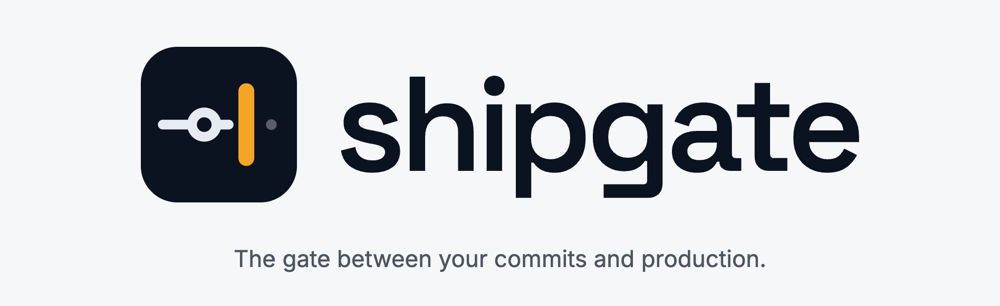

<p align="center">
  
</p>

**A stolen GitHub account shouldn't be able to ship to production.**

shipgate is a deploy gate. It refuses to run code in production unless every
change was signed with a **physical security key**, approved by a **second
enrolled person**, and verified at deploy time against a policy that lives
**outside the code forge**.

> Status: **pre-alpha.** The full path is implemented: `approve`, `merge`,
> image provenance, repo mirror and deploy-time verification. It has not yet
> been run end to end with real hardware keys and a real cluster, so keep the
> webhook in audit mode. Everything fails closed. See
> [docs/issues.md](docs/issues.md) for the v0.1 plan.

## Why

In November 2026 an attacker used a compromised employee GitHub account at
1Password to push malicious code into backend services, which then pulled
customer metadata. Vault contents stayed safe, but a valid GitHub session was
the only thing between the attacker and production. Most pipelines work the
same way.

Branch protection and required reviews are configured by GitHub accounts, so a
stolen admin account can relax them. Keyless signing binds to the same login
that was stolen. shipgate requires something a stolen token can't produce, and
checks it with something the stolen account can't reconfigure.

## How it works

| Attack step | shipgate control |
|---|---|
| Session or token stolen | Commits signed with a FIDO2 key, touch + PIN required (`shipgate enroll`) |
| Push from the stolen account | Second enrolled person approves with their own key (`shipgate approve`) |
| Build and deploy | Admission webhook verifies provenance and gittuf policy outside GitHub (`shipgate webhook-serve`) |
| Policy tampering | Trust root changes need M-of-N hardware signatures (gittuf root) |

shipgate builds on [gittuf](https://github.com/gittuf/gittuf) (policy and
reference state log), in-toto (attestations) and Sigstore/SLSA (build
provenance). It is an opinionated layer on top of them, not a replacement.

## How approval works

> `shipgate approve` and `shipgate merge` are implemented (#10–#12 in
> [docs/issues.md](docs/issues.md#m3-approve-and-merge)) but not yet tested
> against a real gittuf repo and hardware keys. They need the
> [gittuf](https://gittuf.dev) CLI and a repo with gittuf policy; `shipgate init`
> (#8) isn't implemented, so set the policy up with gittuf directly for now.

```sh
# author
git commit                          # touch + PIN, signed with author's key
git push origin feature-x
gittuf rsl record feature-x --remote-name origin   # touch + PIN

# reviewer: reads the diff in the GitHub PR as usual, then
shipgate approve feature-x          # touch + PIN, signed with reviewer's key

# either of them
shipgate merge feature-x            # checks approvals, merges, records it, pushes
```

`shipgate approve` creates a signed attestation, made with the reviewer's own
security key, approving the change from the current tree of `main` to the
proposed tree. It is stored in gittuf's refs (`refs/gittuf/*`), not in GitHub.
Before you touch the key, it shows the commits, their signers and the diffstat.
`shipgate merge` builds a merge commit with exactly the approved tree, runs
`gittuf verify-ref` locally, and pushes the branch and the RSL entry together.
If the remote moved in the meantime, nothing is pushed.

- The approver must be a different enrolled person than the author.
- The approval is bound to the exact tree. Any new commit or force-push voids it.
- It requires a physical touch and PIN.

**Why not GitHub's Approve button?** A GitHub approval is an action taken by a
session. Admins can bypass required reviews, and two stolen accounts can
approve each other. shipgate needs two people's physical keys and PINs.

Teams keep using GitHub PRs for reading code and discussion. `shipgate approve`
is the step that makes the approval count.

## What it won't stop

Read this before deploying it.

- Reading source code with a stolen token. Use short-lived tokens and keep secrets out of repos.
- A malicious workflow stealing CI secrets on an unprotected branch. Scope secrets to protected environments.
- Malware on a developer's machine waiting for a legitimate key touch. PIN-required keys reduce this; they don't eliminate it.
- Rubber-stamped reviews, insider collusion and poisoned dependencies.

See [docs/threat-model.md](docs/threat-model.md).

## Quick look

```sh
make build
./bin/shipgate                                   # list commands
./bin/shipgate enroll --dry-run --comment you@example.com
# is this commit on main, merged with shipgate approve + merge?
./bin/shipgate verify --repo github.com/acme/app --commit <full sha>
# image built by GitHub Actions with actions/attest-build-provenance
./bin/shipgate verify --repo github.com/acme/app --image ghcr.io/acme/app@sha256:...
```

## Roadmap

- **v0.1:** enroll, init (policy pack), approve, merge, verify, admission webhook in audit mode, "stolen token" e2e demo.
- **Later:** break-glass, merge bot with HSM key, Argo CD / Flux plugins, eBPF egress allowlist, GitHub audit-log detection.

## Contributing

Start with [docs/issues.md](docs/issues.md). Issues labelled `spike` come first
because their answers can change the design. `good-first-issue`: #9, #17.

## License

Apache-2.0
